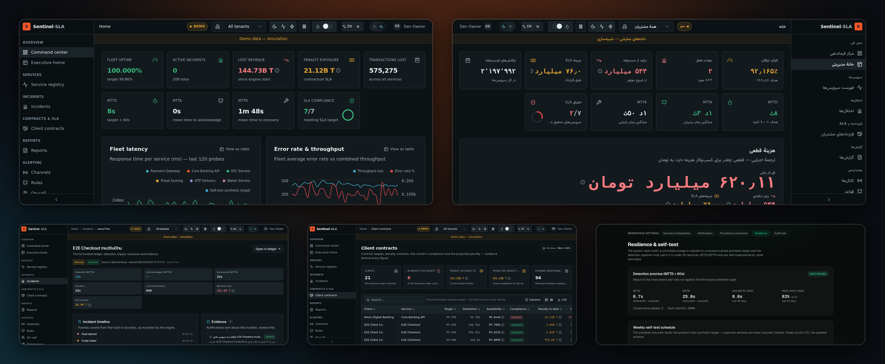
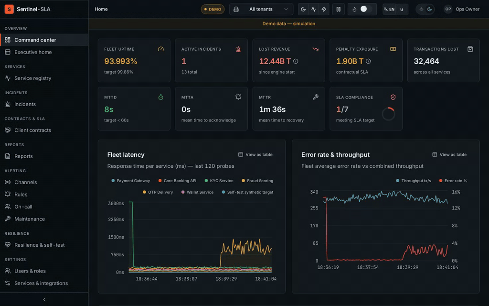
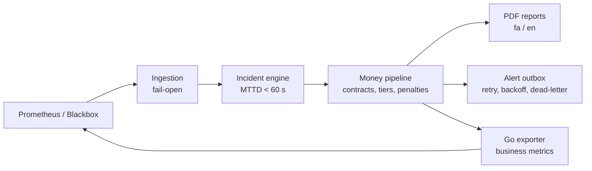

<p align="center"></p>

<h1 align="center">Sentinel-SLA</h1>

<p align="center">
  <b>Turn service outages into money — for the people who sign the SLA, not just the people who read the graphs.</b><br>
  A contract-aware SLA monitoring platform on top of Prometheus, with a production-grade deployment stack for Docker and Kubernetes.
</p>

<p align="center"></p>

<p align="center"></p>

## What it does

Monitoring tools answer in uptimes and HTTP codes. SLA contracts answer in
money. Sentinel-SLA connects the two:

- **Detects** outages from Prometheus / Blackbox probes in under 60 seconds (measured by a built-in self-test).
- **Prices** every incident: lost transactions, lost revenue and contractual penalties, computed with integer arithmetic. There is no float money.
- **Explains** every number: each figure carries its formula and the evidence behind it.
- **Reports** in English and Persian (RTL, Jalali calendar) as PDFs that hold up in a contract dispute.
- **Alerts** engineers in technical language and executives in business language, through Telegram, Bale, webhooks and ticketing.



## Infrastructure and operations

The application is half of the project. The other half is everything
needed to run it like a real service:

| Area | What is included |
|---|---|
| **Containers** | Multi-stage, non-root app image with a health check; distroless, non-root Go exporter image |
| **Kubernetes** | Helm chart: ingress, PVC, Secret handling, optional `ServiceMonitor`, resource limits |
| **Monitoring stack** | Docker Compose with unmodified upstream Prometheus, Alertmanager, Blackbox exporter, Grafana, Loki and Promtail; provisioned dashboards, alert rules and datasources |
| **Operations** | `install.sh`, `backup.sh`, `restore.sh`, `upgrade.sh`, `doctor.sh`, a backup/restore rehearsal script, and TLS reverse-proxy recipes |
| **Reliability** | Separate web and worker roles, lock-protected schedulers, a notification outbox, fail-open ingestion, a weekly self-test that injects a fault on a synthetic target |
| **Supply chain** | CycloneDX SBOM, licence sweep, third-party notices, pinned image versions |
| **CI** | Lint, strict type-check, unit tests, OpenAPI lint and contract tests against a live server, configuration invariants |
| **Security** | Server-side sessions, argon2id, CSRF protection, RBAC with role floors, hashed scoped API tokens, rate limiting, audit trail |

## Quick start

Requires Bun 1.3+, Python 3 and OpenSSL. Demo mode needs no external services.

```bash
cp .env.example .env
bun install
bun run db:generate && bun run db:push
bun run dev            # web + background loops in one process
```

Open <http://localhost:3000>. The first visit walks you through creating the owner account.

For a production-style run, see [`docs/INSTALL.md`](docs/INSTALL.md) (installer, Docker Compose, Helm).

## Documentation

| | |
|---|---|
| [Install](docs/INSTALL.md) · [Operations](docs/OPERATIONS.md) · [Release](docs/RELEASE.md) | Deploy, back up, upgrade, troubleshoot |
| [Architecture](docs/ARCHITECTURE.md) · [Domain model](docs/DOMAIN.md) | C4 diagrams, money and penalty formulas |
| [Security](docs/SECURITY.md) · [API](docs/API.md) | Auth model, permission matrix, generated API reference |
| [User guide](docs/USER-GUIDE.md) · [راهنمای کاربر](docs/USER-GUIDE.fa.md) · [Admin guide](docs/ADMIN-GUIDE.md) | Using and administering the product |
| [Development](docs/DEVELOPMENT.md) · [Design system](docs/DESIGN-SYSTEM.md) | Local setup, tests, chaos experiment, UI rules |

## Stack

Next.js (App Router) · TypeScript · Prisma (SQLite) · Bun · Tailwind / shadcn-ui ·
Go (exporter) · Python + WeasyPrint (PDF) · Prometheus · Alertmanager · Grafana · Loki · Docker · Helm

## Quality

```bash
bun run check                        # eslint + tsc --noEmit + vitest
bash tests/integration/test_stack.sh # deployment and docs invariants
python3 chaos/chaos_experiment.py    # injects an outage and measures MTTD
```

Domain math is characterisation-tested against golden scenarios
(`tests/golden/`). See [`docs/DEVELOPMENT.md`](docs/DEVELOPMENT.md) for the full test pyramid.

## Status and limits

Version 2.0.0. Demo mode is a simulation; live mode ingests real Prometheus data.
The deployment is single-node and SQLite-backed. PostgreSQL is not supported yet: about 100 raw SQL statements need porting, and I will do that when a real deployment requires it. The Helm chart is linted and rendered but has not been run on a live cluster.
See [`docs/SUPPORT.md`](docs/SUPPORT.md) and the [changelog](CHANGELOG.md).

## Licence

Source-available under the [PolyForm Noncommercial License 1.0.0](LICENSE): free to read, run, study
and modify for noncommercial purposes. For commercial use, get in touch. Third-party licences are listed in
[`docs/THIRD_PARTY_NOTICES.md`](docs/THIRD_PARTY_NOTICES.md).

---

<p dir="rtl" align="right">
سنتینل-SLA را با یک باور ساختم: مدیرِ یک شرکت فین‌تک نباید برای فهمیدنِ هزینهٔ یک قطعی منتظر گزارش مهندسان بماند.
برای من زیرساخت فقط سرور و کانتینر نیست؛ یعنی پایشِ درست، هشدارِ قابل‌اعتماد، بازیابیِ تمرین‌شده و مستنداتی که دیگران بتوانند طبق آن‌ها کار کنند.
این پروژه آینهٔ نگاه من به سیستم‌های پایدار است: ساده بسازید، اندازه بگیرید، و هر چه را ادعا می‌کنید قابل‌اجرا نشان دهید.
اگر دربارهٔ زیرساخت، کوبرنتیز یا قابلیت اطمینان گفتگویی در سر دارید، خوشحال می‌شوم بشنوم.
</p>
