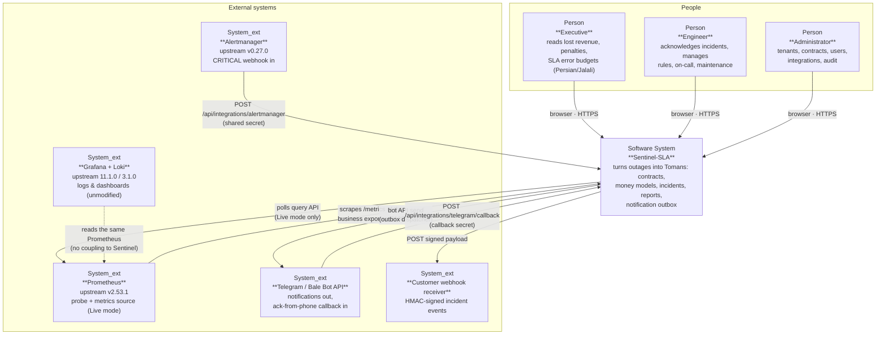
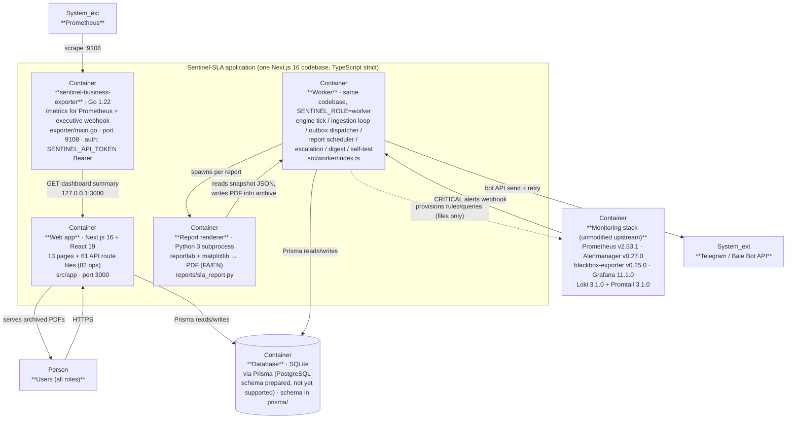
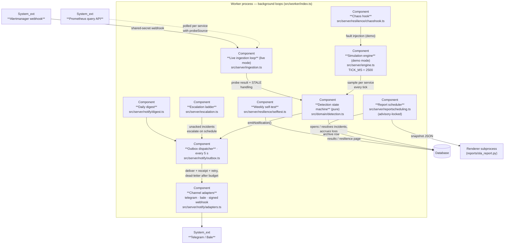

# Sentinel-SLA — Architecture

**Version 2.0.0** · This document describes the system as it is actually built — every
module name, constant and number below is taken from the source tree, not from intent.
It follows the C4 model (Simon Brown) at levels 1–3: **context**, **containers** and
**components**. Diagrams are rendered with mermaid `flowchart` using C4 semantics
(`Person` / `System` / `Container` node types and labelled relationships) so they
display correctly in every mermaid renderer, including GitHub.

Companion documents: [`API.md`](API.md) (generated from `openapi/openapi.yaml`),
[`SECURITY.md`](SECURITY.md) (threat model, authz matrix), [`DOMAIN.md`](DOMAIN.md)
(money/contract semantics), [`OPERATIONS.md`](OPERATIONS.md) (runbooks).

---

## 1. Design principles

The rest of the document shows how the code applies these principles.

1. **Money integrity first.** Every figure a customer can be invoiced for is computed in
   integer arithmetic at the domain boundary (`src/domain/money.ts` — BigInt pipeline,
   no float rounding) or locked by characterisation tests (`tests/unit/engine-money.test.ts`).
   A number that cannot be traced to a formula and its inputs must not appear in the UI.
2. **Offline-first.** The product must run with zero outbound network access. Only
   explicitly configured notification transports (Telegram/Bale bot API, signed webhooks)
   and, in Live mode, the configured Prometheus endpoint are contacted. Demo mode never
   contacts anything.
3. **Demo/live parity.** Both modes share the same detection state machine
   (`src/domain/detection.ts`), the same money math and the same API surface. Demo mode
   feeds the machine from a simulation engine (`src/server/engine.ts`); Live mode feeds it
   from Prometheus polling (`src/server/ingestion.ts`). The simulation code path is never
   started when `SENTINEL_MODE=live`.
4. **Assemble, do not rewrite, the monitoring stack.** Prometheus, Grafana, Loki,
   Promtail, Alertmanager and the blackbox exporter ship as upstream images with upstream
   configuration files under `deploy/`. Sentinel-SLA is the money-and-contract layer on
   top — it never forks them. The single custom component is the business-metrics
   exporter (`exporter/`, Go).
5. **Fail-fast configuration.** All environment is parsed once by zod
   (`src/server/config.ts`) at boot. Unknown or invalid config aborts startup with a named
   variable hint; nothing "guesses" defaults silently.
6. **State in the database, never in memory.** The web process and the worker process
   share a Prisma-managed SQLite database and coordinate through rows and locks — never
   through shared memory. (PostgreSQL is a planned backend; see
   [SUPPORT.md](SUPPORT.md#2-what-is-explicitly-not-supported-in-v200).)
7. **Transactional notifications.** Alerts are emitted into an outbox table and delivered
   asynchronously with receipts, retries, a dead-letter queue and idempotent re-delivery
   (`src/server/notify/outbox.ts`).

---

## 2. C4 Level 1 — System context

Sentinel-SLA sits between a customer's existing Prometheus monitoring estate and the
people who answer for downtime money: executives (who think in Tomans, Persian, Jalali),
engineers (who think in probes, error budgets and evidence) and administrators (who
manage tenants, contracts, users and integrations).



| Actor / system | Relationship | Trust boundary |
|---|---|---|
| Executive / Engineer / Admin | Browser session (argon2id-hashed password, sha256-stored session cookie, role floor: owner > admin > engineer > executive > viewer) | Authenticated, rate-limited |
| Prometheus | Scrapes the **business exporter** sidecar (`:9108`); is polled by the ingestion loop in Live mode | Live mode reads; exporter exposes only non-secret business metrics |
| Alertmanager | `POST /api/integrations/alertmanager` | Shared secret required (503 unconfigured, 401 mismatch) |
| Telegram / Bale | Bot API out; ack callback in | Bot token out; callback secret in |
| Customer webhook | Receives signed incident payloads | HMAC-SHA256 signature header |
| Grafana / Loki | View logs/dashboards beside Sentinel; provisioned read-only against Prometheus | No Sentinel auth involvement |

---

## 3. C4 Level 2 — Containers

One codebase ships in two process shapes (`SENTINEL_ROLE`): **web** (HTTP only) and
**worker** (owns every background loop). In single-node installs both collapse into
`SENTINEL_ROLE=all`. Web and worker share the database — never memory.



| Container | Technology | Responsibility | Source |
|---|---|---|---|
| Web app | Next.js 16, React 19, Tailwind CSS 4, Radix/shadcn UI, recharts | Pages (executive EN/FA, incidents, contracts, reports, alerting, settings, resilience, ack-by-link), 61 API route files / 82 operations, session auth, authz floors, rate limiting, zod validation | `src/app/`, `src/components/` |
| Worker | Same bundle, `SENTINEL_ROLE=worker` | Engine tick (demo), Prometheus ingestion (live), outbox dispatch every 5 s, report scheduling, escalation ladder, daily digest, weekly self-test, chaos hooks | `src/worker/index.ts` |
| Report renderer | Python 3 + reportlab + matplotlib (vendored runtime under `reports/`) | Renders executive/technical/monthly PDFs in EN and Persian (Jalali dates, RTL) from a snapshot JSON; writes into the report archive | `reports/sla_report.py`, `src/server/reportgen.ts` |
| Business exporter | Go 1.22, prometheus/client_golang | Exposes business + financial metrics from the dashboard summary API; translates Alertmanager CRITICAL alerts into executive language (lost tx, Tomans) | `exporter/main.go` |
| Database | SQLite via Prisma 6 (PostgreSQL planned) | Single source of truth: tenants, services, contracts, money-model versions, incidents, outbox, delivery log, users/sessions/audit, integration settings, report schedules | `prisma/schema.prisma` |
| Monitoring stack | Upstream images, upstream configs | Probing, alert rules, dashboards, log storage — **assembled, never rewritten** | `deploy/docker-compose.yml`, `deploy/prometheus/`, `deploy/grafana/`, `deploy/loki/` |

---

## 4. C4 Level 3 — Components

### 4.1 The worker loop cluster (the heart of the product)



Engine constants that matter (all in `src/server/engine.ts`): tick **2500 ms**; metric
snapshots every 12 ticks (≈ 30 s); service list reload every 20 ticks (≈ 50 s); alert-rule
evaluation every 2 ticks (5 s); simulated Alertmanager pipeline delay 1.5–6 s before
`detectedAt` is stamped. Live-mode defaults: **3 consecutive failed probes** open an
incident, **2 consecutive successes** resolve it; Prometheus being unreachable is treated
as **STALE — never healthy and never an outage** — and raises a "monitoring blind" alert
once per staleness episode.

### 4.2 The web request path (every API call)

```mermaid
flowchart LR
  req["Request"] --> proxy["src/proxy.ts<br/>(Next 16 proxy, nodejs runtime)"]
  proxy --> session["Session auth<br/>src/server/auth/session.ts<br/>cookie or Bearer token"]
  session --> floor["Role floor<br/>src/server/authz.ts<br/>owner > admin > engineer ><br/>executive > viewer"]
  floor --> limit["Sliding-window rate limit<br/>(fail-open, Retry-After)<br/>src/server/ratelimit.ts"]
  limit --> zod["Zod body/query validation<br/>src/server/validation.ts"]
  zod --> handler["Handler (src/app/api/**)<br/>server modules: contracts, tenants,<br/>analytics, maintenance, alerts…<br/>src/server/*.ts"]
  handler --> dto["Uniform envelope<br/>src/server/dto.ts<br/>{ok, …} / ErrorEnvelope"]
  dto --> audit["AuditLog row for<br/>sensitive mutations"]
  audit --> res["Response"]
```



Multi-tenant safety: every cross-tenant read goes through `resolveTenantScope` — an
out-of-scope tenant id is a **403**, a single membership auto-narrows, multiple
memberships without a scoping context are rejected rather than guessed.

---

## 5. Money pipeline (why the numbers can be defended)

The product's promise is that every Toman on screen traces to a formula and its inputs.

**Domain core (pure, offline, integer).** `src/domain/money.ts` computes

```
lostValueRials(tps, seconds, ticketRials, lossBps)
  = (round(tps × 1e6) × seconds × ticketRials × lossBps) ÷ (1e6 × 10000)   [BigInt]
```

with `lossBps` in basis points (10 000 = 100 %). All inputs are validated (finite tps in
`[0, 1e6]`, safe-integer seconds, positive integer ticket); anything malformed throws
`DomainError` instead of producing a wrong number. Money models are **versioned per
service** (`src/domain/money-model.ts`): an amendment creates a new version with
`effectiveFrom`, and incidents computed under an old version keep that version's numbers
forever — the audit requirement.

**Simulation accrual (locked by characterisation tests).** In `engine.ts` the per-tick
accrual is `accrueLoss`:

- `down`: `lostTx = tps × 2.5 s`; `revenueLoss += lostTx × avgTransactionValue`
- `degraded`: throughput ratio `r = clamp(throughput ÷ tps, 0, 1)`;
  `lostTx = (1 − r) × tps × 2.5 s`

On resolve, `lostTx = round(windowLostTx)` and `revenueLoss = round(windowRevenueLoss)`
are persisted with the incident, together with the penalty.

**Penalty.** `computePenalty` in `engine.ts` delegates to
`penaltyFixedPerMinute(base, perMinute, seconds, weightPct)` from
`src/domain/contract.ts` — duration rounded to whole minutes with a 1-minute minimum,
`weightPct = 30` for `warning` incidents and `100` otherwise. Contract-level schemes
(`tierForAvailability`) pick percentage-of-fee tiers by availability, honour grace
minutes, exclusion policy (maintenance windows subtract from billable minutes) and the
hard `penaltyCapRials` ceiling. Tier/fixed semantics are specified in
[`DOMAIN.md`](DOMAIN.md) and pinned by `tests/unit/engine-money.test.ts` +
`tests/golden/`.

**Contract math.** Availability for a contract window is computed by
`src/domain/availability.ts` from incident minutes minus excluded minutes (maintenance,
exclusions), never by averaging per-service percentages silently — the formula and the
excluded windows are shown in the UI and embedded in report PDFs.

---

## 6. Demo mode vs Live mode

| Aspect | Demo (`SENTINEL_MODE=demo`) | Live (`SENTINEL_MODE=live`) |
|---|---|---|
| Signal source | Simulation engine tick, 2500 ms | Prometheus HTTP API poll per service (`probeSource`), Alertmanager webhook in |
| Simulation code path | Started | **Never started** (gated in instrumentation + worker entrypoint) |
| Detection | Same state machine (`src/domain/detection.ts`) | Same state machine; defaults 3-fail-open / 2-success-resolve |
| Prometheus unreachable | n/a | STALE state + monitoring-blind alert; never fabricated health |
| Outbound network | **None** | Configured Prometheus URL + configured notification transports only |
| Chaos | In-process fault injection + weekly self-test | Live chaos experiments finalise through `chaoshook` |

The mode is a boot-time zod fact, not a runtime toggle: flipping it means restarting the
process, which keeps the parity guarantee auditable.

---

## 7. Deployment topologies

1. **Single node (smallest).** One process (`SENTINEL_ROLE=all`), SQLite file under
   `SENTINEL_DATA_DIR`, Python renderer beside it. Demo mode out of the box; installed by
   `install.sh` (see [`INSTALL.md`](INSTALL.md)).
2. **docker-compose.** Application: `docker-compose.yml` (`app` + optional `worker` +
   one-shot `migrate`, SQLite on a named volume). Monitoring: `deploy/docker-compose.yml`
   (Prometheus, Alertmanager, blackbox, Grafana, Loki, Promtail and the business
   exporter). Runbooks in [`OPERATIONS.md`](OPERATIONS.md).
3. **Kubernetes (Helm).** Chart `deploy/helm/sentinel-sla`: the app container is
   **env-only** (the zod contract in `src/server/config.ts` is the interface), probes hit
   the public endpoints `/api/health/live` and `/api/health/ready`, the exporter runs as a
   sidecar, `SENTINEL_DATA_DIR` is a PVC (SQLite + report archive), notification tokens
   come from a Secret (or `notify.existingSecret`), and ServiceMonitor support is
   opt-in via `serviceMonitor.release`.

Health semantics: `/api/health/live` = process up; `/api/health/ready` = config +
`SELECT 1` + report-pipeline sub-status (the JSON body names the failing subsystem).

---

## 8. Data model overview

The Prisma schema (`prisma/schema.prisma`) groups into five clusters (exact fields in the
schema; only the shape is repeated here):

| Cluster | Models | Notes |
|---|---|---|
| Tenancy & money | `Tenant`, `Service`, `Contract`, money-model versions | Contracts carry penalty scheme (tiers or fixed+per-minute), cap, grace, exclusions; money models are versioned, incidents pin the version used |
| Operations | `Incident`, incident events, metric snapshots, alert rules, on-call shifts, maintenance windows | Incident rows store evidence events (JSON) and the resolved money figures |
| Notifications | Outbox, delivery log, channels, templates, notification settings | Transactional outbox: pending → sent/dead with receipts; dead letters retryable |
| Identity & audit | `User`, `Session`, `ApiToken`, `Membership`, `AuditLog` | Passwords argon2id (hash-wasm); sessions sha256-stored with idle + absolute expiry; memberships carry per-tenant roles |
| Platform | `IntegrationSetting`, report schedules + runs + archive, resilience/self-test results, chaos experiments | Integrations (Prometheus URL/auth, Telegram chat ids) are **database-managed**, deliberately not env |

---

## 9. Two end-to-end flows

**Incident lifecycle (money path).** A probe fails → detection machine counts the streak →
incident row opens with evidence events (`fault_started`, `probe_failed`) →
`emitNotification` writes outbox rows → the dispatcher delivers to Telegram/Bale/webhook
with an ack deep-link (`ackUrlFor`, tokenised, expiring) → the engineer taps the link
(`/ack/…`) or the executive watches the money strip → resolution (auto-detection or
manual) → `resolveIncident` persists duration, `lostTx`, `revenueLoss` and
`computePenalty` result → the figures appear on the executive home, the incident page
(with the formula and inputs) and the next report PDF. Escalation fires on the ladder if
nobody acknowledges; maintenance windows suppress alerts and mark the minutes excluded.

**Report lifecycle.** A schedule (or manual run) snapshots the window's numbers to JSON →
the Python renderer builds the PDF (EN + Persian, Jalali calendar, RTL-safe fonts) → the
PDF lands in the archive under `SENTINEL_DATA_DIR` with a DB row → download is served
through the authed route → Telegram delivery can attach the file. Regeneration is
explicit and audited.

---

## 10. Extension points

- **New notification channel**: implement an adapter in `src/server/notify/adapters.ts`
  (send + receipt semantics), register it in the outbox dispatch — templates and retries
  are inherited.
- **New business metric for Prometheus**: add a collector in
  `exporter/internal/collector/collector.go`; the exporter is the only custom component
  allowed to touch the monitoring estate.
- **New money basis or tps source**: extend `TxPerSecondSource` in
  `src/domain/money-model.ts` (promql resolvers are injected, keeping the domain pure and
  testable offline).
- **New detection quirk**: `src/domain/detection.ts` is pure and shared by both modes —
  change it once, demo and live move together.

---

*Diagram source lives inline in this file. When you change the architecture, update
these diagrams in the same commit.*

---

<p dir="rtl" align="right"><sub>معماری خوب یعنی بتوانید هر تکه را بدون ترس عوض کنید.</sub></p>

