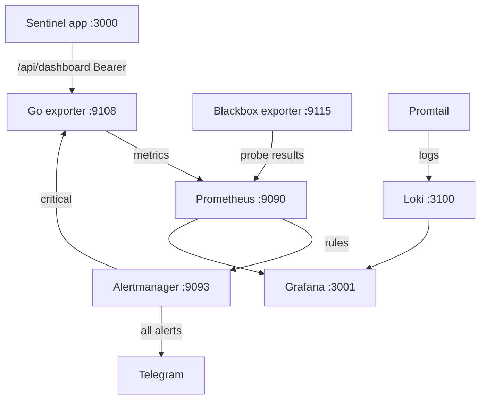

# Development Guide

Sentinel-SLA turns service outages into money: lost transactions and SLA
penalties, reported in Tomans. This guide sets up a complete development
and evaluation environment on one machine: the app, PDF reports, the
monitoring stack, and the test suites.

For production installs (`./install.sh`, TLS, Kubernetes/Helm) see
[INSTALL.md](INSTALL.md). For backups, upgrades and day-2 work see
[OPERATIONS.md](OPERATIONS.md).

## Contents

1. [Architecture at a glance](#architecture-at-a-glance)
2. [Requirements](#requirements)
3. [Run the app](#run-the-app)
4. [PDF reports](#pdf-reports)
5. [Monitoring stack](#monitoring-stack)
6. [Tests and chaos](#tests-and-chaos)
7. [Known limitations](#known-limitations)
8. [Troubleshooting](#troubleshooting)

## Architecture at a glance

- **App**: Next.js (TypeScript, strict) with Prisma on SQLite. It has two
  processes: **web** (dashboard and JSON API, port 3000) and **worker**
  (background loops: simulation engine in demo mode, Prometheus ingestion
  in live mode, report scheduler, escalation, digests).
- **Monitoring stack**: seven containers in `deploy/` that collect metrics,
  store logs, draw dashboards and send alerts.



More detail: [ARCHITECTURE.md](ARCHITECTURE.md), [DOMAIN.md](DOMAIN.md).

**Fastest path.** To just get the app running (demo or live), `./install.sh`
does the setup below non-interactively when you export
`SENTINEL_NONINTERACTIVE=1 SENTINEL_MODE=demo SENTINEL_PUBLIC_BASE_URL=http://localhost:3000`.
It builds, starts in the background (logs in `data/run/web.log`, stop with
`kill $(cat data/run/web.pid)`), and writes `REPORT_PYTHON` into `.env`.
Use the manual steps below for a development server.

## Requirements

Supported development platforms: **Fedora 44** and **Ubuntu 24.04**.

| Tool | Purpose | Needed for |
|---|---|---|
| Bun 1.3+ | Package manager, app, worker, scripts, tests | The app |
| Git | Source control | Everything |
| Python 3.10+ | PDF reports, chaos and load tests | Reports, tests |
| OpenSSL | Required by the Prisma engine | The app |
| curl | Service checks | Verification |
| Docker with Compose | Monitoring stack | Monitoring only |

No Node.js, Go or compiler is needed: Bun runs the app and tests, and
Docker builds the exporter. WeasyPrint additionally needs the Pango
library (see [PDF reports](#pdf-reports)). Plan for 8 GB RAM, 10 GB free
disk and internet access for downloads.

**Fedora 44**

```bash
sudo dnf upgrade --refresh -y
sudo dnf install -y git python3 python3-pip curl unzip openssl
curl -fsSL https://bun.sh/install | bash
```

**Ubuntu 24.04** (`python3-venv` is needed for the report virtualenv)

```bash
sudo apt update && sudo apt upgrade -y
sudo apt install -y git python3 python3-pip python3-venv curl unzip openssl
curl -fsSL https://bun.sh/install | bash
```

Open a new terminal and verify:

```bash
bun --version          # 1.3 or higher
docker --version && docker compose version   # only for the monitoring stack
```

**Docker access** (monitoring stack only):

```bash
sudo systemctl enable --now docker
sudo usermod -aG docker $USER      # then log out and back in
docker ps                          # must work without sudo
```

### Ports

| Port | Service |
|---|---|
| 3000 | Sentinel app (Next.js) |
| 3001 | Grafana |
| 3100 | Loki |
| 9090 | Prometheus |
| 9093 | Alertmanager |
| 9108 | Go exporter |
| 9115 | Blackbox exporter |

```bash
ss -ltn | grep -E ':(3000|3001|3100|9090|9093|9108|9115)\b'   # no output = all free
```

## Run the app

On first run the app seeds six demo fintech services and three tenants
(a tenant is a client company).

### Setup

```bash
git clone <repo-url> sentinel-sla && cd sentinel-sla
cp .env.example .env     # documents every setting; defaults work for development
bun install              # 2-5 minutes
bun run db:generate      # Prisma client
bun run db:push          # create the SQLite tables
```

Keep `DATABASE_URL=file:../db/custom.db` as shipped. The app validates the
whole `.env` at boot and refuses to start on an unknown or malformed
setting; the error names the variable.

Relevant settings (all documented in `.env.example`):

| Variable | Meaning |
|---|---|
| `SENTINEL_MODE` | `demo` (default, simulation) or `live` (Prometheus ingestion) |
| `SENTINEL_ROLE` | `all` (default), `web` or `worker` |
| `SENTINEL_DATA_DIR` | Data directory (default `./data`) |
| `SENTINEL_PUBLIC_BASE_URL` | Public URL used in links and notifications |
| `REPORT_PYTHON` | Python interpreter for PDF reports |

### Development mode

One process serves the UI and runs the background loops. Use it for fast
iteration.

```bash
bun run dev
```

The log prints `[sentinel] engine started — 6 services, 2500ms tick, mode=demo`.
Open <http://localhost:3000>.

**First login.** A fresh database has no users, so the app redirects to
`/setup`, where you create the owner account (e-mail, name, password).
There is no default username or password. Afterwards log in at `/login`.

**Health check.** The health endpoints are public:

```bash
curl -s http://localhost:3000/api/health/ready     # {"status":"ok",...}
```

Data endpoints such as `/api/dashboard` require a browser session or a
Bearer API token (see [Tests and chaos](#authentication-for-command-line-work)).

### Production mode (web + worker)

Use it for realistic behaviour, load tests and the monitoring stack.

```bash
bun run build     # 1-3 minutes; also assembles the standalone server
bun run start     # web process (sets HOSTNAME=0.0.0.0 so containers can reach it)
bun run worker    # second terminal: background loops
```

In demo mode the worker runs the simulation engine. With
`SENTINEL_MODE=live` it runs the Prometheus ingestion loop instead and the
simulation never starts. A process started with `SENTINEL_ROLE=web` never
ticks the engine, by design. Keep both terminals open while using the
monitoring stack and tests.


## PDF reports

Reports are rendered as PDF in English and Persian (RTL layout, Jalali
dates, Persian digits). HTML templates are rendered with **WeasyPrint**
through `reports/render_weasy.py`. Fonts (Vazirmatn, Inter) ship in
`public/fonts/`, so no system fonts are needed and output is identical on
any host. PDFs are written to `data/reports/` (inside `SENTINEL_DATA_DIR`).

```bash
python3 -m venv .venv
.venv/bin/pip install -r reports/requirements.txt   # pins the tested WeasyPrint
```

WeasyPrint needs the Pango system libraries, usually already present:

```bash
sudo dnf install -y pango                                                         # Fedora
sudo apt install -y libpango-1.0-0 libpangocairo-1.0-0 libgdk-pixbuf-2.0-0        # Ubuntu
```

Restart the app so it re-detects the interpreter, then create a report from
the Reports section of the dashboard, or via the API:

```bash
curl -s -X POST http://localhost:3000/api/reports \
  -H 'Content-Type: application/json' -H "Authorization: Bearer $SENTINEL_TOKEN" \
  -d '{"periodHours":24}'
```

**Interpreter detection order**: `REPORT_PYTHON`, the legacy alias
`PYTHON_BIN`, `<repo>/.venv/bin/python3`, then the first `python3` on
`PATH`. If nothing resolves, the error says what to set. The resolved
interpreter is logged at boot and the pipeline state appears in
`/api/health/ready`. `SENTINEL_FONT_DIR` (alias `FONT_DIR`) only affects the
legacy reportlab script `reports/sla_report.py`, which is not on the report
path.

## Monitoring stack

Seven containers, all defined in `deploy/docker-compose.yml`:

| Service | Purpose | Port |
|---|---|---|
| Prometheus | Metrics and alert rules | 9090 |
| Grafana | Dashboards | 3001 |
| Loki | Log storage | 3100 |
| Promtail | Ships container logs to Loki | none |
| Alertmanager | Sends alerts to Telegram and the exporter | 9093 |
| Blackbox exporter | Probes web addresses | 9115 |
| Sentinel exporter | Go service that turns app data into Toman metrics | 9108 |

Prerequisites: the app running in production mode on
`http://localhost:3000`, and Docker usable without `sudo`.

### 1. Let containers reach the app

The compose file pins the container network to `172.30.250.0/24`. Trust it
in the host firewall.

```bash
# Fedora (firewalld)
sudo firewall-cmd --permanent --zone=trusted --add-source=172.30.250.0/24
sudo firewall-cmd --reload

# Ubuntu (only if ufw is active)
sudo ufw allow from 172.30.250.0/24 to any
```

### 2. Validate the configuration

```bash
bash tests/integration/test_stack.sh     # last line: ALL CHECKS PASSED
```

### 3. Configure credentials

```bash
cd deploy
cp .env.example .env
```

Edit `deploy/.env`:

- `GRAFANA_ADMIN_PASSWORD`: replace `change-me`. Without the file, the
  password is `sentinel-admin`.
- `SENTINEL_API_TOKEN`: required. The exporter reads the app's dashboard
  API, which rejects unauthenticated requests. Mint a token from the repo
  root and paste it in:

```bash
bun scripts/mint-loadtest-token.mjs --name exporter --days 365
```

Without a valid token the exporter logs `dashboard fetch failed ... HTTP 401`
and Prometheus receives no `sentinel_*` metrics.

### 4. Start

```bash
docker compose up -d --build     # first start: 5-10 minutes (images + Go build)
docker compose ps                # all seven containers Up
docker compose logs NAME         # if one is Restarting or Exited
```

### 5. Verify each service

Wait about 30 seconds after start.

```bash
curl -s http://localhost:9108/metrics | grep sentinel_ | head -n 12   # sentinel_service_up{...}
curl -s http://localhost:3100/ready                                   # "ready" (Loki needs ~20 s)
```

- **Prometheus** (<http://localhost:9090/targets>): `prometheus`,
  `blackbox-exporter` and `sentinel-exporter` are UP. The six
  `fintech-blackbox` rows are DOWN by design (placeholder addresses, see
  below).
- **Alertmanager**: <http://localhost:9093> loads.
- **Grafana** (<http://localhost:3001>, user `admin`): two provisioned
  dashboards:
  - *Sentinel-SLA — Fintech Fleet Overview*: `/d/sentinel-overview`
  - *Sentinel-SLA — Contracts & Money*: `/d/sentinel-contracts-money`
    (fleet money position, penalties, budgets)
- **Logs**: in Grafana Explore choose Loki and run `{job="fintech-services"}`.

### 6. Test the executive translation

The exporter turns a critical alert into an executive message with revenue
loss and SLA penalty. Send a test alert:

```bash
curl -s -X POST http://localhost:9108/webhook/executive-alert -H 'Content-Type: application/json' \
  -d '{"status":"firing","alerts":[{"status":"firing","labels":{"alertname":"ServiceDown","service":"payment-gateway","severity":"critical"},"annotations":{"summary":"Test alert"}}]}'
docker compose logs sentinel-exporter | tail -n 8     # shows EXECUTIVE BRIEF
```

### Real probe targets

The six addresses under `fintech-blackbox` in
`deploy/prometheus/prometheus.yml` are placeholders (`*.example.ir`) that
never answer, so `ServiceDown` fires for all six after one minute. To
probe real endpoints, replace them and run
`docker compose restart prometheus`. For self-signed certificates, change
`module: [http_2xx]` to `module: [http_2xx_insecure]`.

### Telegram alerts (optional)

The stack works without Telegram; Alertmanager just logs failed sends.

1. Message `@BotFather`, send `/newbot`, copy the token.
2. Send any message to the new bot, then open
   `https://api.telegram.org/bot<TOKEN>/getUpdates` and copy
   `"chat":{"id":<NUMBER>`.
3. In `deploy/alertmanager/alertmanager.yml`, replace
   `PUT_YOUR_BOT_TOKEN_HERE` with the token and `123456789` with the chat id
   (a number, no quotes).
4. `docker compose restart alertmanager`.
5. If Telegram is blocked, set `HTTPS_PROXY: http://your-proxy:port` under
   the `alertmanager` service's `environment:` in `docker-compose.yml`.

Never commit a real token. App-level channels (Telegram, Bale, webhook,
and others) are configured in the app under Settings → Integrations.

### Day-to-day

Run these in `deploy/`:

| Action | Command |
|---|---|
| Stop, keep data | `docker compose down` |
| Start again | `docker compose up -d` |
| Stop and delete all data | `docker compose down -v` |
| Rebuild the exporter | `docker compose up -d --build sentinel-exporter` |
| Follow logs | `docker compose logs -f` |

Containers use `restart: unless-stopped`; after a reboot only the app
(`bun run start`, `bun run worker`) needs starting. Backup, restore and
upgrade scripts are covered in [OPERATIONS.md](OPERATIONS.md).

## Tests and chaos

| Check | Command | Time |
|---|---|---|
| Lint + types + unit tests | `bun run check` | ~1 min |
| Config validation | `bash tests/integration/test_stack.sh` | 10 s |
| API contract | `bun run test:contract` | ~1 min |
| Authorization matrix | `bun run test:authz` | ~1 min |
| Chaos experiment | `python3 chaos/chaos_experiment.py ...` | ~2 min |
| Load test | `python3 tests/load/load_test.py ...` | 1 min |
| Browser E2E (Playwright) | `bun run test:e2e` | ~5 min |

Further scripts: `bun run test:domain` (unit tests with coverage),
`bun run test:visual` (PDF pixel comparison), `bun run lint:spec`
(OpenAPI lint). Run everything from the repo root; the integration, chaos
and load tests need the app on port 3000.

### Authentication for command-line work

The data API requires authentication. Contract, chaos and load tests use a
Bearer API token. The raw token prints once; only its hash is stored.

```bash
bun scripts/mint-loadtest-token.mjs --name qa --days 1
export SENTINEL_TOKEN=stlt_...
bun scripts/mint-loadtest-token.mjs --revoke --name qa      # when finished
```

The token inherits its user's fleet role, which covers the engineer floor
that `POST /api/chaos` requires. `test:contract` and `test:authz` also read
`SENTINEL_TOKEN`.

### Lint, types, unit tests

```bash
bun run check     # eslint + tsc --noEmit (strict) + vitest; all must be green
```

### Stack validation

`bash tests/integration/test_stack.sh` validates every deploy config, the
OpenAPI contract, docs invariants and packaging rules without starting
anything. Expected last line: `ALL CHECKS PASSED`.

### Chaos test

Chaos engineering breaks a service on purpose to prove the monitoring
notices. The gate is MTTD (mean time to detect) below 60 seconds.

```bash
python3 chaos/chaos_experiment.py --base http://localhost:3000 \
  --service payment-gateway --type outage --duration 45 --gate 60 \
  --token "$SENTINEL_TOKEN"
```

Exit code 0 means PASS; a 401 means the token is missing or revoked. To
run all six services (~5 minutes):

```bash
SENTINEL_TOKEN="$SENTINEL_TOKEN" bash chaos/auto_chaos.sh
```

| Variable | Default | Meaning |
|---|---|---|
| `SENTINEL_BASE` | `http://localhost:3000` | App address |
| `SENTINEL_TOKEN` | none | Bearer API token (required) |
| `SENTINEL_CHAOS_TYPE` | `outage` | `outage`, `latency` or `error-spike` |
| `SENTINEL_CHAOS_GATE` | `60` | MTTD limit in seconds |
| `SENTINEL_CHAOS_DURATION` | `45` | Seconds per experiment |

The chaos tooling uses only the Python standard library. For a weekly
run, add to `crontab -e` (every Monday 03:00):

```
0 3 * * 1 SENTINEL_BASE=http://localhost:3000 SENTINEL_TOKEN=stlt_... /opt/sentinel/chaos/auto_chaos.sh >> /var/log/sentinel-chaos.log 2>&1
```

Fedora needs `sudo dnf install -y cronie && sudo systemctl enable --now crond`;
Ubuntu ships cron. Prefer reading the token from a restricted file over
inlining it, and rotate it like any credential.

### Load test

The target is 1000 requests per second against the authenticated API. Use
production mode; a development server on a laptop will likely miss it.

```bash
# smoke
python3 tests/load/load_test.py --url http://localhost:3000/api/dashboard \
  --token "$SENTINEL_TOKEN" --rate 100 --duration 15 --threads 10
# full gate
python3 tests/load/load_test.py --url http://localhost:3000/api/dashboard \
  --token "$SENTINEL_TOKEN" --rate 1000 --duration 60 --threads 50
```

PASS needs at least 900 requests per second and under 1% errors. A FAIL on
a laptop measures the hardware, not a setup error; lower `--rate` to find
your limit.

### End-to-end walkthrough

1. Run the app (production mode) and the monitoring stack.
2. Run the chaos experiment above.
3. In Grafana, incidents, lost transactions and revenue loss change.
4. <http://localhost:9090/alerts> may show `SLABudgetBurn` or
   `TransactionLossBurning` firing.
5. `docker compose logs sentinel-exporter` (in `deploy/`) shows an
   `EXECUTIVE BRIEF` for critical alerts.

## Known limitations

- **Demo mode is a simulation.** The six fintech services, incidents and
  money figures are generated by the engine (2.5 s tick) from the formulas
  in [DOMAIN.md](DOMAIN.md); they are model outputs, not production
  measurements. Live mode replaces the simulation with Prometheus
  ingestion, but the services it watches are whatever you point it at.
- **App and monitoring stack measure different things.** In demo mode the
  app reports its simulated fleet while blackbox probes real addresses.
  The placeholder probe targets never answer, so `ServiceDown` fires; this
  is expected until you configure real targets.
- **Notifications need configuration.** Without a bot token, sends are
  logged, not delivered. Channels implemented: Telegram, Bale, webhook,
  SMTP e-mail, Mattermost, Jira, Redmine. SMS and Slack are not. SMTP
  supports plain AUTH or implicit TLS only (no STARTTLS). See
  [SUPPORT.md](SUPPORT.md).
- **Single-node.** No high availability and no horizontal scaling of the
  web or worker process. Background loops take an advisory lock, so a
  second worker is safe but idle.
- **SQLite only.** `DATABASE_URL` is a file. A PostgreSQL schema exists,
  but about 100 raw SQL statements in `src/server/` use SQLite identifier
  rules, so the app fails on Postgres with `relation "tenant" does not
  exist`. Do not point `DATABASE_URL` at Postgres.
- **The Helm chart is linted and rendered, not cluster-tested.** `helm lint`
  passes and both guarded and default variants render, but no cluster has
  run it.
- **Verification coverage.** The installer (demo mode), production build,
  dev server, `bun run check` and the static stack checks were run on
  Fedora 44 with Bun and no Node.js installed. Ubuntu 24.04 and a clean-VM
  install are documented but have had less hands-on testing.
- **Exporter tests need Go.** They are committed; run
  `cd exporter && go test ./...` (Go 1.22+). The app itself does not need Go.
- **PDF visual baselines are host-dependent.** `bun run test:visual`
  compares pixels with images from the original build host; different
  Pango/FreeType versions shift anti-aliasing. Inspect the PDFs and
  re-approve with the script's `--update` flag on your reference machine.
- **Dev-server quirks.** Long-lived Turbopack sessions can serve a
  permanent skeleton while the API stays healthy; restart `bun run dev`.
  The production build is the reference.
- **Multi-tenant scope.** A user with several tenant memberships picks one
  at a time; merged fleet-wide views for non-admins are not implemented.
- **Home page payload.** Initial JS is about 309 KB gzip against a 250 KB
  budget; LCP passes.
- **Release artifacts.** `release/` ships the SBOM only; `bun run release`
  (clean git checkout required) produces the tarball, `SHA256SUMS` and
  `RELEASE-MANIFEST.json`. See [RELEASE.md](RELEASE.md).
- **Third-party licences.** Grafana, Loki and Promtail run as unmodified
  upstream images (AGPL); sharp's prebuilt libvips is LGPL and dynamically
  loaded; production npm packages are permissive. See
  [THIRD_PARTY_NOTICES.md](THIRD_PARTY_NOTICES.md).

## Troubleshooting

### App

| Symptom | Fix |
|---|---|
| `bun: command not found` | Open a new terminal, or `source ~/.bashrc`. |
| App refuses to start and names an env var | Fix that variable, or start clean with `cp .env.example .env`. |
| Prisma OpenSSL / query engine error | Install `openssl` (`dnf`/`apt`), then `bun run db:generate`. |
| `Port 3000 is already in use` | `ss -ltnp \| grep :3000`; stop the old process. |
| `401 Authentication required` | Expected. Log in at `/login` (first run: `/setup`), or mint a token (see above). A `403` naming a role means the token's user lacks that role. |
| Dashboard loads but never changes | In production, start `bun run worker`. The log line `engine started — 6 services, 2500ms tick` shows the loops are alive. |
| Reset all data | `bun run db:reset` (deletes everything; demo data is recreated). |

### PDF report error 500

The end of the error text names the missing piece.

- `WeasyPrint is not installed for this interpreter`: run
  `.venv/bin/pip install -r reports/requirements.txt`.
- `cannot import weasyprint` or a Pango error: install the Pango libraries
  (see [PDF reports](#pdf-reports)).
- No interpreter found: create `.venv`, set `REPORT_PYTHON`, or start the
  app from the repo root.
- Check pipeline state with `curl -s http://localhost:3000/api/health/ready`.

### Docker

| Symptom | Fix |
|---|---|
| `permission denied` on `/var/run/docker.sock` | `sudo usermod -aG docker $USER`, log out and in. |
| `Cannot connect to the Docker daemon` | `sudo systemctl enable --now docker`. |
| Image pulls fail or hang | Your network blocks Docker Hub or `gcr.io`; configure a proxy or mirror. Images used: `prom/prometheus`, `grafana/grafana`, `grafana/loki`, `grafana/promtail`, `prom/alertmanager`, `prom/blackbox-exporter`, `golang:1.22-alpine`, `gcr.io/distroless/static-debian12`. |
| Exporter build fails at `go mod tidy` | Go modules cannot download; fix connectivity or add `ENV GOPROXY=https://proxy.golang.org,direct` before `RUN go mod tidy` in `exporter/Dockerfile`. |

For a restarting container, run `docker compose logs --tail 40 SERVICE`
in `deploy/`:

| Log message | Cause and fix |
|---|---|
| `permission denied` on a config file | SELinux. Compose mounts with `:ro,z`; run `docker compose up -d --force-recreate`. |
| Alertmanager `cannot unmarshal` / `chat_id` | `chat_id` must be a number without quotes. |
| Loki `field ... not found` | Typo in `loki-config.yml`; fix the named field. |
| Port already allocated | Another program uses it; see the port check under [Requirements](#ports). |

### Exporter cannot reach the app

Symptom: `curl http://localhost:9108/metrics` shows no `sentinel_` lines.

1. **HTTP 401** in the exporter log: the token is missing or revoked. Mint
   one, set `SENTINEL_API_TOKEN=stlt_...` in `deploy/.env`, then
   `docker compose up -d --force-recreate sentinel-exporter`.
2. `ss -ltn | grep :3000` must show `*:3000` or `0.0.0.0:3000`. If it shows
   `127.0.0.1:3000`, start with `bun run start`.
3. Confirm `172.30.250.0/24` is trusted:
   `sudo firewall-cmd --zone=trusted --list-sources` (Fedora) or
   `sudo ufw status` (Ubuntu).
4. Test from inside the Docker network (JSON means the path works; a
   timeout means the firewall blocks it):

```bash
docker run --rm --network deploy_sentinel-net --add-host host.docker.internal:host-gateway \
  curlimages/curl -s -m 5 http://host.docker.internal:3000/api/health/ready
```

5. `docker compose restart sentinel-exporter`.

### Prometheus, Grafana, Telegram

- `fintech-blackbox` DOWN and `ServiceDown` firing: expected with the
  placeholder targets (see [Real probe targets](#real-probe-targets)).
- **Grafana login fails**: default is `admin` / `sentinel-admin`, or the
  password in `deploy/.env`. Grafana stores the password at first start;
  reset by `docker compose down -v` and starting again (this deletes data).
- **Panels show "No data"**: check that `sentinel-exporter` is UP at
  `/targets`, wait 30 s (15 s scrape interval), and note that
  `sentinel_mttd_seconds` appears only after the first incident. Some
  money panels in *Contracts & Money* need contracts created in the app.
- **Logs panel empty**: check `curl -s http://localhost:3100/ready` and
  `docker compose logs --tail 20 promtail`. A `docker.sock` permission
  error is SELinux; Promtail runs with `label=disable`, so recreate it:
  `docker compose up -d --force-recreate promtail`.
- **No Telegram messages**: `docker compose logs alertmanager | grep -i telegram`.
  `chat not found` means a wrong chat id (message the bot first);
  `Unauthorized` means a wrong token; a timeout means Telegram is blocked,
  so set `HTTPS_PROXY`.

### Chaos and load tests

- **401**: mint and export `SENTINEL_TOKEN` (see
  [Authentication](#authentication-for-command-line-work)).
- **`could not list services`**: the app is not running on port 3000, or
  the token is invalid.
- **Load test FAIL**: use production mode and lower `--rate` to find your
  hardware's limit.

---

<p dir="rtl" align="right"><sub>کدی که اجرا نشود، فقط ادعاست. اول اجرا کنید، بعد اعتماد کنید.</sub></p>
